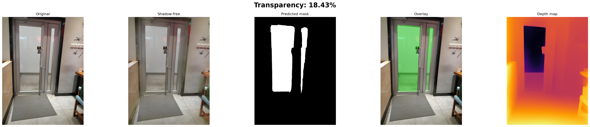
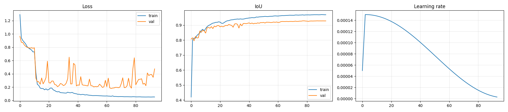

# Transparent Object Detection with Shadow Removal and Depth Estimation

A vision pipeline that detects transparent surfaces (glass doors, windows, bottles) in real-world photographs, removes cast shadows from the input, estimates per-pixel depth, and reports an overall transparency percentage of the scene.

## Pipeline

```
input image
   │
   ▼
[ Shadow removal ]   ← Attention U-Net pre-trained on ISTD
   │
   ▼
shadow-free image ──► [ Depth estimation ]   ← MiDaS (DPT-Large)
   │                                                │
   ▼                                                ▼
[ Transparent-object segmentation ]              depth map
   │      ← PyramidalNet (Swin-Tiny + pyramidal decoder)
   ▼
[ Mask post-processing ]
   │      ← morphological closing/opening + small-blob removal
   ▼
binary mask + transparency %
```

A single `predict.py` invocation runs the full pipeline end-to-end.

## Example output

Running `predict.py` on a sample image:

```
python predict.py examples/sample_input.jpg --out_dir examples
```



Five panels: original input · shadow-free version · predicted binary mask · green overlay on the original · MiDaS depth map. The transparency percentage in the title is the area of the predicted mask divided by image area.

## Training

Training curves for the segmentation model (95 epochs, early stopped, cosine LR with warmup):



## Results

PyramidalNet was trained on the shadow-removed Trans10K training split (5,000 images). All numbers below are on the held-out validation set with test-time augmentation (horizontal flip) and morphological post-processing applied.

| Split | F1 | IoU | Precision | Recall | Accuracy |
|---|---|---|---|---|---|
| val_easy (788 imgs, all) | **0.973** | **0.955** | 0.964 | 0.986 | 0.984 |
| val_easy (298 with transparent) | 0.932 | 0.884 | 0.909 | 0.966 | 0.957 |
| val_hard (212 imgs, all) | 0.875 | 0.822 | 0.855 | 0.918 | 0.927 |
| val_hard (130 with transparent) | 0.811 | 0.726 | 0.778 | 0.881 | 0.885 |
| **Combined (1000 imgs, all)** | **0.952** | **0.927** | **0.941** | **0.971** | **0.972** |
| Combined (428 with transparent) | 0.895 | 0.836 | 0.869 | 0.940 | 0.935 |

Two aggregations are reported per split: *all images* (which rewards a correctly-empty prediction when no transparent object is present), and *only images that contain a transparent object* (the more demanding number).

## Quick start (inference)

### 1. Install

```bash
git clone https://github.com/Utk2804/transparent-object-detection.git
cd <repo>
pip install -r requirements.txt
```

For a GPU build of PyTorch matching your CUDA version, follow the
[official install guide](https://pytorch.org/get-started/locally/) before running `pip install -r requirements.txt`.

### 2. Download pretrained weights

Two files are needed. Download both from the latest **GitHub Release** of this repo and place them in `models/`:

```
models/
├── best_attunet.pth                              (~360 MB)   shadow remover
└── best_pyramidal_net_shadowfree_v2.pth          (~110 MB)   transparent-object segmenter
```

### 3. Run inference

```bash
python predict.py path/to/your/image.jpg
```

Output: a 5-panel visualization PNG and a binary mask PNG saved under `predictions/`.

```
[load] device=cuda
[load] shadow remover : models/best_attunet.pth
[load] segmentation   : models/best_pyramidal_net_shadowfree_v2.pth
[run]  path/to/your/image.jpg
[done] transparency: 21.05%  |  inference: 0.54s
       visualization -> predictions/your_image_result.png
       binary mask   -> predictions/your_image_mask.png
```

### Useful flags

```
--out_dir DIR          # where to write outputs (default: ./predictions)
--threshold 0.30       # segmentation probability threshold
--no_tta               # skip test-time augmentation (faster, slightly worse)
--no_postprocess       # raw threshold output (skip morphology + blob removal)
--no_depth             # skip MiDaS depth estimation (no internet needed)
--att_unet PATH        # override AttentionUNet weights path
--segmentation PATH    # override PyramidalNet weights path
```

The first run with depth estimation downloads ~1.3 GB of MiDaS weights to `.torch_cache/` (skip with `--no_depth`).

## Reproducibility

### Dataset

This repo does not bundle the dataset. Download Trans10K (transparent object segmentation) from the original authors and arrange it as:

```
Dataset/
├── train/{images, masks}
├── validation/easy/{images, masks}
├── validation/hard/{images, masks}
└── test/{easy, hard}/{images, masks}
```

Trans10K uses 3-class masks: pixel value `0` = background, `76` = opaque "things",
`255` = **transparent things** (the only class this pipeline detects).

For training the shadow remover, the [ISTD shadow dataset](https://github.com/DeepInsight-PCALab/ST-CGAN) is also required.

### Generate shadow-removed training images

```bash
python inference_shadow_removal.py
```

Writes `Dataset_shadow_free/{train, validation, validation_hard}/images/` so that the segmentation model can be trained on the same distribution it sees at inference time.

### Train the segmentation model

```bash
python PyramidalNet_train.py
```

Defaults: Swin-Tiny backbone, 100 epochs (early stopping with patience 15), cosine LR schedule with linear warmup, BCE+Dice loss, AdamW, mixed-precision training, RandomResizedCrop with joint image/mask augmentation, batch size 4 with 4-step gradient accumulation. Saves the best checkpoint by validation IoU on the combined val_easy + val_hard set.

### Train the shadow remover (optional)

```bash
python train_attention_unet.py \
    --train_shadow path/to/ISTD/train/train_A \
    --train_gt     path/to/ISTD/train/train_C \
    --val_shadow   path/to/ISTD/test/test_A \
    --val_gt       path/to/ISTD/test/test_C \
    --use_ssim
```

### Evaluate

```bash
python evaluate_pipeline.py                     # val_easy + val_hard
python evaluate_pipeline.py --split test        # test_easy + test_hard
python evaluate_pipeline.py --split val_easy --no_tta
```

## Project structure

```
.
├── predict.py                       # single-image inference (entry point)
├── evaluate_pipeline.py             # batched eval with per-image metrics
├── PyramidalNet_train.py            # segmentation training + PyramidalNet model
├── train_attention_unet.py          # shadow-remover training
├── inference_shadow_removal.py      # batch shadow-free dataset generator
├── attention_unet.py                # Attention U-Net architecture
├── pipeline_postprocess.py          # morphology cleanup + TTA helpers
├── losses.py                        # uncertainty-weighted L1 + SSIM loss (shadow training)
├── dataset_istd.py                  # ISTD dataset class (shadow training)
├── run_overnight.bat                # convenience wrapper for shadow-free + train
├── requirements.txt
├── .gitignore
└── README.md
```

## Architecture notes

- **Shadow removal**: Attention U-Net trained on ISTD (paired shadow / shadow-free) with an L1 + SSIM loss, weighted by learned uncertainty.
- **Segmentation backbone**: Swin Tiny (`swin_tiny_patch4_window7_224`, ImageNet-pretrained via `timm`).
- **Decoder**: lightweight pyramidal head — 1×1 channel reduction then four `ConvTranspose2d` stages back to input resolution, single sigmoid output for transparent-vs-background.
- **Loss**: weighted BCE-with-logits + soft Dice (1:1).
- **Inference TTA**: horizontal flip; predictions averaged in probability space before thresholding.
- **Post-processing**: morphological closing (5×5 ellipse) → opening (3×3 ellipse) → drop connected components smaller than 0.5 % of the image area.

## Limitations

- The shadow remover was trained on **general scenes (ISTD)**, not on transparent objects specifically. It may slightly distort glass edges. The segmentation model is trained on the post-shadow-removal distribution to compensate.
- Only the **transparent class (Trans10K class index ≈ 255)** is detected; opaque foreground objects are intentionally ignored.
- Depth maps come from a frozen pre-trained MiDaS — they are relative depth, not metric.
- Tested on Windows 11 with an RTX 3050 Ti (4 GB VRAM). CPU inference works but is roughly 50× slower; expect ~25 s per image on CPU vs ~0.5 s on the GPU above.

## Acknowledgements

- Trans10K dataset: Xie et al., *Segmenting Transparent Objects in the Wild*, ECCV 2020.
- ISTD shadow dataset: Wang et al., *Stacked Conditional Generative Adversarial Networks for Jointly Learning Shadow Detection and Shadow Removal*, CVPR 2018.
- MiDaS: Ranftl et al., *Towards Robust Monocular Depth Estimation*, TPAMI 2020.
- Swin Transformer: Liu et al., *Swin Transformer: Hierarchical Vision Transformer using Shifted Windows*, ICCV 2021.
- Attention U-Net: Oktay et al., *Attention U-Net: Learning Where to Look for the Pancreas*, MIDL 2018.
